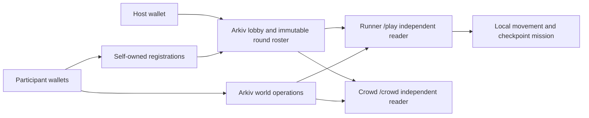

# RIFT RUN — Mumbai Venue Mission

One runner completes a venue mission while other participants reshape the route with wallet-owned, expiring Arkiv edits. Built from scratch for **Arkiv — Build on Arkiv** at ETHGlobal Mumbai.

**Current boundary:** the checkpoint game, wallet lobby and edit pipeline are implemented. Local tests pass. Real multi-wallet writes/expiry and phone gameplay are not yet verified: the local access key is absent and all four script wallets last checked have zero tGLM. No verified RIFT RUN writer addresses or transaction hashes are available yet. Do not describe practice as onchain proof.

## Run one website

Requirements: Node >=22.12 and npm. From PowerShell:

```powershell
Set-Location E:\rift-run
npm.cmd install
npm.cmd run dev
```

- Home: http://localhost:5173/
- Runner: http://localhost:5173/play
- Crowd: http://localhost:5173/crowd
- Public website: https://rift-run-mumbai-2026.madhanxdev.chatgpt.site — native Sites publication succeeded. This verifies deployment, not live Arkiv gameplay; see the evidence record.

One Vite process serves both views. The old guest-vote server is not required. Build with `npm.cmd run build`; the static artifact is `dist/`, including direct `/play/` and `/crowd/` entry files. `npm.cmd run preview` serves the production build on port 4173.

## Play

1. Open Runner and click **LET'S RUN**.
2. Move with WASD/arrows. Press E at checkpoint 1, the registration approach.
3. At checkpoint 2 beside Hacking Space West, hold E for three seconds to build the demo. Leaving resets unfinished progress.
4. Deliver the packet to checkpoint 3 at the mentor approach and press E.
5. Reach the marker inside Main Stage before the round ends.

Touch controls include movement and Interact. Checkpoint completion and movement are local/offchain; scores are not cheat-proof onchain achievements. The venue is a game adaptation, not real navigation or emergency guidance.

Without a live invite/configuration, both views say **SIMULATED PRACTICE**. Practice edits sync through localStorage between tabs in the same browser/origin. Open Crowd in another tab, select a team/site and submit a simulated edit. Practice is not synchronized between phones or separate browsers, and never qualifies as live Arkiv evidence. Use `?mode=practice` to explicitly choose practice even if live environment identifiers exist.

## Live wallet setup and flow

Use dedicated test wallets and test tGLM. Never paste private keys or quota keys into chat. The existing local `.env` is ignored; do not replace its test-wallet fields or regenerate wallets accidentally.

1. Follow [plan.md section 6](plan.md#6-access-key-and-funding-setup) for the official [Rabdi access-key](https://hub.arkiv.network/access-keys) and [faucet](https://hub.arkiv.network/faucet) flow.
2. Configure `ARKIV_ACCESS_KEY` for scripts and `VITE_ARKIV_ACCESS_KEY` for browser reads. Browser quota keys are visible; add the actual development/deployed origins to the Hub configuration. A quota key does not pay wallet gas.
3. Run `npm.cmd run preflight`. The four local script wallets and their balances are printed without their keys. Attendees use and fund their own browser-wallet accounts.
4. At Home, **CREATE ARKIV LOBBY** with the host's funded connected wallet. Share the resulting Crowd QR/link. The link pins the host, lobby and world; use a trusted host invite.
5. Each participant connects their wallet, chooses Builder/Breaker, and signs one readonly registration entity. The host locks up to 16 eligible wallets in the round manifest, then the round starts at a future block. Late arrivals/team changes wait for a new lobby.
6. Roster members personally sign edits. The Runner applies them only after real Arkiv reads and validation. The host does not sign participant edits.
7. For a rematch, create a new lobby and share its new invite. Old pinned rounds do not silently switch to new ones.

Rabdi: chain ID **7794095**, gas **tGLM**, plain wallet RPC `https://rpc.rabdi.db-chain.testnet.arkiv.network`. Do not install a quota-key-bearing RPC URL into a wallet. Desktop requires an EIP-1193 wallet extension; phones need the site opened in a compatible wallet browser. Mobile provider behavior remains to be tested on real phones.

## Real integration proof and runnable query

```powershell
Set-Location E:\rift-run
npm.cmd run preflight
npm.cmd run spike
```

The spike requires the configured host plus three distinct funded test signers. It creates a lobby, has each participant sign their own registration, pins the roster, publishes concurrent operations, queries actual records, and checks before/after native expiry. It writes incremental actual results to ignored `.local/live-evidence.json`, and public session identifiers to `.local/session.public.env`. Missing funds/credentials fail visibly; they do not produce mock successes.

Copy the public identifiers into the corresponding existing `.env` fields to reproduce a round, then run:

```powershell
npm.cmd run read:world
```

The script prints the exact raw query with that real world/round and normalized metadata/hashes. Implementation: [adapter](packages/arkiv-adapter/src/index.ts), [query CLI](scripts/read-world.ts). A short-lived operation may already be gone when a later query runs; an empty ended-round world is not replay of its past edits. Actual writer addresses and entity/transaction links must be added here after live execution; none are invented in this README.

## Architecture and limits



- Protocol v2 uses versioned lobby, registration, round and operation schemas. Creator/owner, readonly flags, pinned membership, role, geometry, creation phase and expiry are validated by the client.
- Each wallet can have two active candidate edits. Conflict losers consume capacity and may become visible later; expiry frees capacity. This is not a permanent per-round budget or an onchain spam ban.
- A central bridge opens a useful shortcut. Every permitted wall set preserves routes to all tasks and the stage; overlap triggers a safe spawn rather than trapping the runner.
- Storage expiry is native Arkiv block expiry; effective gameplay lifetime is additionally capped by creation block and round end. No expiration-event subscription is assumed.
- Reads are latest-state and eventually consistent. Pinned readonly configuration prevents attribute drift; owner/expiry metadata is refreshed. Pagination is bounded and rejects inconsistent scans. Equal head numbers alone are not proof of equal inputs: compare the input digest and evaluation block, then world hash.
- Host controls admission/round configuration; wallets do not prove separate humans. There is no anti-Sybil or cheat-proof-score claim. Gas, confirmation/indexing delays and public RPC quota affect onboarding.
- The live game does not require an application database or vote service. It still depends on hosting, wallet providers and Arkiv RPC availability. Stale live reads pause gameplay instead of switching to fixtures.

## Verification and documentation

`npm.cmd run check` runs typecheck, tests and the production build. Tests cover convergence, duplicate delivery, conflicting registrations, pinned rosters, roles/phases, expiry, caps, pagination, mission rules, route impact and same-browser simulation. These are local tests, not live transport or human gameplay proof.

See [plan.md](plan.md), [evidence](docs/evidence.md), [schema](arkiv/schema.md), [friction](arkiv/friction.md), [reach](arkiv/reach.md), [why Arkiv](arkiv/why-arkiv.md), [how Arkiv is used](arkiv/how-you-use-arkiv.md), and [AI disclosure](docs/ai-usage.md).

## Credits

User supplied the ETHGlobal Mumbai venue-map reference, concept and product direction. The map is redrawn in original SVG/grid code and retains recognizable landmarks; event marks/layout belong to their respective owners. No official endorsement is implied. Libraries include Arkiv SDK, viem, React, Vite, Phaser, QRCode.react and Vitest; see package-lock.json and their licenses. DM Sans and Barlow Condensed are served through Google Fonts with local system fallbacks. Source is MIT licensed.
