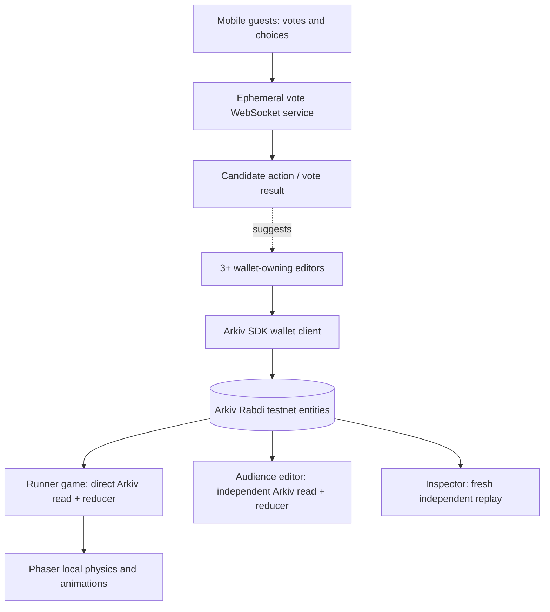

# RIFT RUN — Master Build Context for Codex

> **Project:** RIFT RUN — The Crowd Controls Reality  
> **Event:** ETHGlobal Mumbai 2026  
> **Primary sponsor:** Arkiv — **Build on Arkiv (from scratch)**, $4,000 pool ($3,000 first, $1,000 second)  
> **As-of:** 6 November 2026 (IST)  
> **Official submission deadline:** **Sunday, 8 November 2026, 09:00 IST**. Verify again in Hacker Dashboard.  
> **Status:** Full specification / planned MVP. **NOT built, tested, deployed, or submitted.**  
> **Execution guidance:** Start with an Arkiv onchain write/read spike and deterministic reconciliation tests. Build polished game UX only after that works.

---

## 0. Instructions to Codex — read first

You are the lead implementation collaborator on a **fresh hackathon project**. Read this entire file before making changes. We are building **a browser-playable crowd-controlled action platformer** that also demonstrates a reusable, multi-writer Arkiv world-state protocol. The intended submission is Arkiv's **Build on Arkiv (from scratch)** prize only. Do **not** quietly add Hedera, NFTs, a token, a DAO, AI agents, or payment rails.

### Mandatory engineering behavior

1. **Use the current, official Arkiv Rabdi documentation**, verify APIs in the installed SDK before coding, and do not invent SDK method names.
2. **Never fake a successful onchain integration.** Display `SIMULATED`, `PENDING`, or `CONFIRMED ON ARKIV` labels accurately. Mock-only tests do not qualify as the live proof.
3. Build from scratch during the hackathon, use standard open-source libraries with attribution, and make **small, meaningful Git commits** as work progresses. Do not manufacture a backdated or cosmetic commit history.
4. Protect all keys; do not commit private keys, access keys, seed phrases, deployed wallet secrets, or user identifying information. Never use real funds or production wallet keys for this demo.
5. Implement and test **at least three distinct Arkiv wallet-owned operations** from separate player wallets. Guest votes may be offchain, but don't represent them as wallet-owned Arkiv transactions.
6. Make at least **two independently runnable applications** consume the same Arkiv entities and derive the same world state: **Runner Game** and **Audience World Editor**. A third standalone read-only inspector is desirable.
7. Every committed world alteration must come from **actual Arkiv reads**; no locally faked confirmation. Immediate local movement/animations and offchain voting are fine and should be disclosed.
8. State-machine/merge code must be pure and thoroughly tested. The UI must never trust unauthenticated operation attributes such as `claimedWallet` when Arkiv's `$creator`/`$owner` metadata is available.
9. If a dependency can't be made to work, document the actual blocker in `/arkiv/friction.md`, stop overstating the feature, and preserve a runnable minimal onchain vertical slice.
10. Record AI-assisted files, prompts, major design decisions and human testing/contributions, as the ETHGlobal rules require.

### Definition of success

> A judge scans a QR code and influences a fun two-minute round. Meanwhile, three separate funded wallet owners write game changes to Arkiv; two separately runnable clients independently query those entities, deterministically merge simultaneous edits, show an expiring bridge disappear, and a fresh client reconstructs the same authoritative world without our application-specific database.

This is **eventually consistent shared world state**, not 60-FPS onchain gameplay.

---

## 1. The actual problem, in plain English

People can play a game together, but the world and edits usually live inside **one company's game server**. Different game applications cannot easily share a world, and multiple independent players writing conflicting changes need trusted central coordination to decide what happened.

**Proposed solution:** Build a **wallet-owned, queryable, expiring multi-writer world-state layer on Arkiv**, with a crowd-controlled platformer as the exciting real-world demonstration. Different clients read the same records, filter them by world and round, independently apply deterministic conflict rules, and render the same outcome.

**User-level hook:** **“One runner. The whole crowd controls the world.”**

**What is new for this submission:** Our particular game/world protocol and integration, not the existence of crowd-controlled games, CRDTs, collaborative editors or blockchains. Prior art includes crowd-interaction games and Arkiv's Quire/Yjs provider. Do not claim to invent CRDTs or the first collaborative game.

---

## 2. Sponsor alignment, exactly

**Track:** Arkiv — **Build on Arkiv (from scratch)**.

Official bounty: https://ethglobal.com/events/mumbai/prizes/arkiv  
Docs: https://docs.arkiv.network  
Arkiv ecosystem challenges: https://hub.arkiv.network/ecosystem  
Arkiv AI tools: https://hub.arkiv.network/ai-tools

This isn't a separate prize for making a game. We qualify under **Build on Arkiv**, demonstrating two Arkiv Hub innovation directions:

1. **Multi-Writer Collaborative State:** multiple independently controlled wallets publish operations that all clients reconcile.
2. **Shared Cross-App Schemas:** the Runner Game and Audience Editor are separate applications consuming one public versioned world schema.

### Required judging documentation — 25% each

| Judging area | Required file | How RIFT RUN demonstrates it |
|---|---|---|
| Arkiv feedback (25%) | `/arkiv/friction.md` | Reproducible SDK/RPC/query/wallet problems encountered, what was expected, actual result, steps to reproduce, suggested improvement |
| Reach (25%) | `/arkiv/reach.md` | Actual participants, first-time join flow, real try-it URL, what users do, retention hypothesis; no invented statistics |
| Why Arkiv (25%) | `/arkiv/why-arkiv.md` | Independently owned shared world records readable by any client, without trusting our private centralized DB; honest alternatives/limits |
| How Arkiv is used (25%) | `/arkiv/how-you-use-arkiv.md` | Indexed filtered queries, author/wallet ownership, short-lived structures, independently rendered results |

Additional mandatory `/arkiv/schema.md` enumerates **every entity, indexed fields, owner, purpose, and expiration policy**.

### Qualification checklist (must truly satisfy)

- [ ] Fresh project-specific work started only after event kickoff; comply with ETHGlobal Classic/From Scratch rules.
- [ ] Actual write to **current Arkiv testnet**, using `@arkiv-network/sdk` or JSON-RPC.
- [ ] At least one user-visible feature **actually reads Arkiv data**; preferably all confirmed world-change rendering.
- [ ] README lists **real writer wallet addresses** and **one runnable Arkiv query**.
- [ ] `/arkiv/schema.md` complete.
- [ ] `/arkiv/friction.md`, `/arkiv/reach.md`, `/arkiv/why-arkiv.md`, `/arkiv/how-you-use-arkiv.md` complete and supported by evidence.
- [ ] Public GitHub repo, open-source license (MIT recommended), reproducible setup steps.
- [ ] AI usage and human contribution disclosed; spec/prompts/plans committed.
- [ ] A public functional demo plus evidence of confirmed Arkiv writes and reads.
- [ ] Select **Arkiv** in ETHGlobal's partner-prize submission step.

**Not qualifying:** Installing the SDK but reading a fake/local DB; writing Arkiv only as a log nobody reads; all edits signed by one game server wallet while claiming multiple real owners.

---

## 3. Exact MVP gameplay: RIFT RUN

### Target users and first impression

- **Runner:** one player on a laptop / projector controls a nimble character (keyboard: WASD/arrows + Space). Short action platformer.
- **Audience:** visitors scan a QR code; on a mobile web page, they join either the **BUILDERS** (help the runner) or **BREAKERS** (hinder the runner) team. No download or mandatory wallet for *guest voting*.
- **Verified Builders (demo role):** three explicitly connected, funded Arkiv wallets can publish genuine world edits as independent owners. The wallet-aware experience may be a separate panel; guests should not be blocked by wallet setup.
- **Judge:** can view live Arkiv operation keys and creator addresses, see expiration, and open an independent inspector to reproduce state.

### Game rules — keep tight, reproducible and fun

- Map: **24 × 12 tile grid**, fixed deterministic starter map with spawn, exit, ground, gaps and obstacles.
- Round: **120 seconds**, with a visible timer and a final escape/survival outcome.
- Every **10 seconds**, announce a **REALITY SHIFT**. Pull confirmed world operations from Arkiv, validate them and compute the next visible structure state. Do not claim zero-latency chain updates.
- **BUILDERS** can propose `BRIDGE` and `BOOST_PLATFORM` at legal sites.
- **BREAKERS** can propose `WALL` and `SLOW_ZONE` at legal sites.
- Temporary structures survive roughly **30–60 seconds** on Arkiv, depending on network blocks and the chosen TTL, then stop applying.
- One memorable power: a bridge is visible, the runner starts crossing, the countdown reaches zero, and the bridge **vanishes**. Provide a fair visual warning and prevent unwinnable softlocks.
- Game ends if runner reaches exit or time runs out. Short intermission with scoreboard, “your intervention mattered,” and QR invite to rematch.
- No real-value rewards, gambling, NFTs, tokens or unsafe purchases.

### Player engagement loop

1. Scan QR (or use shareable URL with `room` parameter).
2. Select **Builders** or **Breakers**, choose display nickname (optional and never stored on public Arkiv).
3. Tap a tile to propose a structure; see pending counts and vote results in the fast guest channel.
4. Watch the Reality Shift apply confirmed Arkiv world changes, with a visible creator attribution for actual onchain editors.
5. Get score/impact summary; invite others to the next round.

### Honest two-layer interaction model

**Layer A — low-latency audience engagement (offchain):** many guests vote, point to tiles and see live counts over a small WebSocket or Socket.IO server. Guests are *not* automatically onchain writers; do not imply otherwise.

**Layer B — Arkiv authoritative world changes (onchain):** authorized wallet holders issue actual world operation transactions. The majority guest vote can suggest the next action, but the approved publisher is the **wallet that actually signs the edit**. Show “crowd decision proposed” vs “wallet X committed” separately. The runner applies confirmed changes from Arkiv reads, not just the vote server's opinion.

**Optional stretch:** One-click ephemeral browser session wallets, funded with limited test GLM, so crowd members can each own operations. This needs secure lifecycle, faucet availability and UX validation. Not a required dependency for launch.

---

## 4. Critical architectural claim and boundaries

**What Arkiv does:** immutable/controlled entity writes (per wallet), public read/query interface, indexed discovery of records, expiry by block, and provenance through entity metadata.

**What our software does:** gameplay, physics, optimistic visuals, team votes, role authorization, per-round action budget, deterministic merge and conflict resolution, timeout notifications, UI and simulation.

**What Arkiv does NOT do for us:** instant game-frame updates, automatic CRDT merging, atomic multi-agent locking, guaranteed abuse prevention, expiry events, physical server availability, or anonymous privacy.

Arkiv may show new entity events, but its expiration **does not emit an event**. The client must refresh/recompute expired structures based on current block and `$expiresAt`.

A named schema is **not an authenticity credential**: anyone can imitate a schema tag. Validate the authoritative world manifest's owner and operation `$creator`, plus an allowlist/role policy, before applying changes.

---

## 5. Technical stack — sensible defaults, not sacred

| Layer | Choice | Reason |
|---|---|---|
| Game | Phaser 3 + TypeScript | Browser-ready 2D physics, fast iteration |
| Frontends | React + Vite + TypeScript | Mobile guest controls, admin, inspector |
| Shared state protocol | Plain TypeScript package; pure reducers | Reusable by Runner and Audience applications |
| Arkiv | `@arkiv-network/sdk` + `viem` | Official network reads/writes |
| Wallet | EIP-1193 browser wallet, viem; funded Rabdi test wallets | Independently owned edits |
| Guest live channel | Small Node/Socket.IO service | Low latency guests, not authoritative chain state |
| Tests | Vitest; Playwright optional for smoke | Deterministic convergence and gameplay acceptance |
| Deployment | Static frontend(s) + small websocket host | Shareable live links and QR |

Use maintained, permissively licensed game assets or draw original simple pixel shapes. Credit every third-party asset; do not reuse a previous hackathon's project-specific code/design.

### Intended monorepo

```text
riftrun/
  apps/
    runner/                 # Standalone Runner Game build
    crowd/                  # Mobile QR guest audience + authorized world editor
    inspector/              # Standalone no-backend Arkiv state explorer (stretch)
  packages/
    world-protocol/         # Schema v1, validation, merge, replay, permissions
    arkiv-adapter/          # Read/write, query, subscriptions/polling, retry, block timing
    game-core/              # Pure physics/game rules and deterministic map logic
    ui/                     # Optional shared display primitives
  server/
    guest-channel/          # Votes, real-time spectators, rate limits; NOT world source of truth
  scripts/
    testnet-spike.ts
    register-world.ts
    seed-authorized-writers.ts
    read-world.ts
    reproduce-query.ts
    verify-convergence.ts
  tests/
    fixtures/
    adversarial/
  arkiv/
    schema.md
    friction.md
    reach.md
    why-arkiv.md
    how-you-use-arkiv.md
  docs/
    architecture.md
    demo-script.md
    decisions.md
    ai-usage.md
    project-context.md       # Copy of this spec
  .env.example
  LICENSE
  README.md
  package.json
```

Keep **`packages/world-protocol` framework-independent**; no React or Phaser imports in schema/merge code.

### High-level architecture



The guest server may vanish and gameplay participation may degrade. However, **two clients should still query and reconstruct Arkiv-confirmed world state without the guest server**. Don't claim real-time spectator gameplay works with no servers.

---

## 6. Arkiv network and verified API references

**Current testnet:** Rabdi  
**Chain ID:** `7794095`  
**Gas token:** `tGLM` test token  
**HTTP RPC:** `https://rpc.rabdi.db-chain.testnet.arkiv.network`  
**WS RPC:** `wss://rpc.rabdi.db-chain.testnet.arkiv.network`  
**Explorer:** `https://rabdi.explorer.arkiv.network`  
**Faucet:** `https://hub.arkiv.network/faucet`  
**Access key:** `https://hub.arkiv.network/access-keys`  
**Approx. block time:** 2 seconds, NOT a game-frame time guarantee.

Relevant official docs:
- https://docs.arkiv.network/networks/rabdi/
- https://docs.arkiv.network/start-here/clients/
- https://docs.arkiv.network/start-here/first-entity/
- https://docs.arkiv.network/schemas/define/
- https://docs.arkiv.network/writing/create/
- https://docs.arkiv.network/writing/expiration/
- https://docs.arkiv.network/querying/filter/
- https://docs.arkiv.network/reference/limits/
- https://docs.arkiv.network/reference/query-language/

**Limits to respect:** at most 31 user columns in named schema (32 including name tag), attribute name <= 32 bytes, UTF-8 `str` <= 128 bytes, entity bytes <= 128 KiB, query page <= 100 results, indexed filters only. Paginate robustly. Avoid a write per screen frame. Use distinct schemas and short payloads.

Access keys are quota credentials: do not hard-code them in source. A browser access key can be visible to visitors; restrict it to expected origins if used. **Do not add an access-key-bearing RPC URL to someone else's wallet network config.** Use the plain chain URL for wallet connections; use keyed endpoint for application reads.

### Tested-against-docs minimal API pattern (verify SDK version locally)

```ts
import { createPublicClient, createWalletClient, ExpirationTime } from "@arkiv-network/sdk";
import { rabdi } from "@arkiv-network/sdk/chains";
import { defineSchema, str, i32, bytes } from "@arkiv-network/sdk/schema";
import { and, eq } from "@arkiv-network/sdk/query";
import { http, stringToBytes } from "viem";
import { privateKeyToAccount } from "viem/accounts";

const WorldOps = defineSchema("riftrun.world-ops.v1", {
  worldId: str().indexed(),
  roundId: str().indexed(),
  phase: i32().indexed(),
  x: i32().indexed(),
  y: i32().indexed(),
  kind: str().indexed(),
  opId: str(),
  payload: bytes(),
});

const chain = rabdi({ accessKey: process.env.ARKIV_ACCESS_KEY ?? "" });
const publicClient = createPublicClient({ chain, transport: http() });
const walletClient = createWalletClient({
  chain,
  transport: http(),
  account: privateKeyToAccount(process.env.DEMO_WRITER_PRIVATE_KEY as `0x${string}`),
});

// For server-only spike. Never ship a private key to browser.
const created = await walletClient.createEntity(
  WorldOps,
  {
    worldId: "demo-world",
    roundId: "round-001",
    phase: 1,
    x: 8,
    y: 4,
    kind: "BRIDGE",
    opId: "writerA-0001",
    payload: stringToBytes(JSON.stringify({ length: 2, version: 1 })),
  },
  { expiration: ExpirationTime.fromSeconds(60) },
);
console.log("Arkiv entity key, tx, expiry:", created.entityKey, created.txHash, created.expiresAt);

const page = await publicClient
  .select({
    $key: true, $creator: true, $owner: true, $expiresAt: true,
    worldId: true, roundId: true, phase: true, x: true, y: true,
    kind: true, opId: true, payload: true,
  })
  .from(WorldOps)
  .where(and(eq("worldId", "demo-world"), eq("roundId", "round-001")))
  .fetch();
console.log("Real onchain entities:", page.entities);
```

**This is an example, not evidence of a successful transaction.** Confirm exact installed SDK behavior with the docs and TypeScript compiler. Onchain writing in the deployed browser must use the **connected wallet** (SDK + viem custom transport / wagmi), not expose `DEMO_WRITER_PRIVATE_KEY` in bundled JavaScript.

---

## 7. Data model (source of truth)

Use a **versioned public schema** and enforce a bounded number of operations per writer per round.

### A. `riftrun.world.v1` — authoritative world manifest

- Fields: `worldId` indexed, `activeRoundId` indexed, `mapVersion`, `mapHash`, `roundStartBlock`, `phaseLengthBlocks`, `baseMap` bytes or content digest, plus optionally a `schemaVersion`.
- **Owner/writer:** the verified event host/organizer wallet. Clients pin a trusted manifest **entity key and owner address** from the real session invite; never trust “latest world” by schema alone.
- **Expiration:** 7 days (renew or reconstruct for subsequent events). Does not mean infinite retention.
- **Effect:** defines starting map, current round and authorized data lineage; shared across both applications.

### B. `riftrun.member.v1` — authorized world editors

- Fields: `worldId` indexed, `roundId` indexed, `player` indexed `addr`, `role` indexed, `maxOps`, `memberNonce` and any issuance metadata.
- **Owner/writer:** **organizer wallet only**, verified by `$owner` and/or `$creator` relative to pinned host key; a member cannot self-certify their role.
- **Expiration:** a little longer than the round (e.g., 10 minutes). If membership vanishes, new operations should not be accepted. Keep any historical audit needed for demo offchain or within a longer-lived audit record.
- **Effect:** separate wallets are authorized to make specific world edits; malicious cloned membership records rejected.

### C. `riftrun.world-ops.v1` — multi-writer edits

- **Index:** `worldId`, `roundId`, `phase`, `x`, `y`, `kind`; select `$owner`, `$creator`, `$key`, `$expiresAt`.
- **Data:** unique operation key `opId`, `kind` (`BRIDGE`, `BOOST_PLATFORM`, `WALL`, `SLOW_ZONE`), coordinates, bounded payload JSON bytes, a proposed `nonce` or local sequence.
- **Owner/writer:** **each independently connected player wallet**; creator must match an authorized member for the round/role. The Arkiv metadata is the provenance, not a copyable `claimedWallet` field.
- **Expiration:** ~60 seconds for demo structures (about 30 blocks at expected timing). Do not assume exact wall-clock TTL. Can demonstrate shorter 20–30s TTLs if SDK accepts even multiples of 2 seconds.
- **Effect:** actual bridges/walls vanish after their TTL; independent clients query the same operations to render confirmed structures.

### D. `riftrun.round-result.v1` — round result (optional after core)

- **Fields:** worldId indexed, roundId indexed, outcome, score, winningSide, evidenceHash, configuration digest, replay metadata.
- **Owner:** organizer wallet.
- **Expiration:** 7–30 days; publish a clear testnet example.
- **Effect:** optional shareable scorecard and post-match replay; **not** mandatory for core score calculations.

### Important schema design rules

- Store **no spectator names, IP addresses, wallet private keys, or identity secrets on Arkiv**.
- Store nickname and rapid votes in transient offchain memory or consent-based ephemeral server storage only.
- Arkiv doesn't enforce global row-level role rules for **other peoples' inserts**. Every client must verify the creator/member relationship.
- All public writes are attributable to wallet addresses but do not prove one human per wallet; anti-Sybil claims are out of scope.
- **Never let untrusted operations replace the base map**. Base map is host-owned and pinned.
- Arkiv indexed queries are not full SQL joins; implement any multi-entity association in the client/shared package.

---

## 8. Deterministic multi-writer reconciliation — the core technical innovation

Do **not** pretend Arkiv automatically provides CRDT merge semantics. Build and test a **commutative, order-independent world-operation reducer** suitable for a tile game. Name it a “CRDT-inspired merge” unless we actually prove the formal properties of a specific CRDT. Yjs is prior art for documents; don't simply clone Quire.

### Required merge invariants

1. **Convergence:** Given the same valid set of confirmed unexpired operations and same trusted manifest/memberships, Runner and Audience calculate **byte-identical canonical state hashes**, regardless of retrieval order.
2. **Idempotence:** Applying the same operation twice is equivalent to applying it once (dedupe by unique Arkiv `$key`).
3. **Commutativity:** `merge(A, B) = merge(B, A)` for valid operations.
4. **Associativity:** `merge(merge(A,B),C) = merge(A,merge(B,C))` for the chosen canonical state model, verified in tests.
5. **Role enforcement:** Unauthorized creators and disallowed action types are ignored and visibly flagged.
6. **Budget enforcement:** Per-wallet operation count per phase is capped deterministically. A client chooses accepted operations using a canonical order by unique onchain entity key, not message arrival order.
7. **Bounds enforcement:** Only permitted coordinates and payload parameters; do not allow trapping runner in spawn tile or removing goal.
8. **Expiry enforcement:** A record with `$expiresAt <= currentBlock` does not apply to the current world, even if cached earlier.
9. **No invented history:** Expired operations might no longer be queryable. Don't claim perfect replay of expired data; store durable round snapshots separately if needed.

### Safe initial reconciliation algorithm

For each round and authoritative phase:

1. Read trusted world manifest and authorized-member records.
2. Query relevant confirmed world operations from Arkiv; paginate and dedupe.
3. Validate each operation's schema, `$creator`, role, round, coordinates, phase, payload and current expiry. Reject schema-spoofed or unauthorized records.
4. Group by `creator + phase`; **sort by `$key` lexicographically**, accept first `maxOps` to limit spam *deterministically*. This is a policy rather than onchain rate limiting; the rejected records still cost writers gas.
5. Group accepted operations by target tile. If multiple operations compete for one tile, select a **deterministic winner** using a fixed public rank, e.g. `SHA256(worldId | roundId | phase | entityKey)` and then entity key tie-breaker. This is order-independent; it is **not secret randomness or strong anti-griefing**.
6. Apply winning operations as overlays on an immutable host-owned map. Rendering uses local physics; no per-frame writes.
7. Hash a **sorted canonical JSON** of the resulting grid plus round/phase/active expiry block(s). Compare hashes between clients after both have observed the same confirmed record set / checkpoint.
8. At the next Reality Shift or expiry transition, recompute from active records instead of mutating previously cached state in place.

**Why the hash approach?** It makes concurrent conflict resolution repeatable when operations arrive in different orders. It does **not** prevent a strategic actor from creating many competing operations; the per-wallet cap reduces but doesn't eliminate that risk. Use controlled demo accounts and acknowledge the limitation.

### State timing nuance

Arkiv queries return data from the latest chain, and separate clients may observe different blocks temporarily. We should promise **eventual convergence after both observe a shared confirmed cutoff**, not instant perfect synchronization. For reproducible judge tests, compare clients after both show the same `currentBlock` or same accepted operation-key set. Do not invent block-pinned historical reads if SDK doesn't support them.

### Expiration nuance

To demo a bridge disappearing, query `$expiresAt` and `getBlockTiming()` or equivalent verified documented current-block read, refresh around expiry, and remove expired overlay from the renderer. There is **no expiry event**. Re-query as the block advances; if RPC is down, mark state **STALE / UNVERIFIED**, not “still active.”

---

## 9. Two different applications, not merely two browser tabs

**App 1: Runner Game** (e.g. `runner.example-host`)
- Phaser canvas with world, avatar, collision/physics, countdown, live score.
- Uses `@riftrun/world-protocol` and `@riftrun/arkiv-adapter` to query and derive authoritative confirmed world structures.
- Provides a transparent **Arkiv proof inspector** button (entity keys, creator wallets, expiry, accepted/rejected status).

**App 2: Crowd World Editor** (e.g. `crowd.example-host`)
- Mobile first with QR join, team selection, tile target UI, pending votes and participation counter.
- For funded members, shows Wallet Connect, registered role, submit world operation, pending confirmation, confirmed entity key.
- Independently queries Arkiv world data and derives a mini-map using the same **versioned protocol**, without using Runner's private backend as its world-state source.

**Optional App 3: Inspector**
- Fresh, standalone read-only page with a pasted world ID, manifest key and approved host address.
- Queries Arkiv, displays operation provenance, expiry and world hash; independent reproduction for judges.

Publish `packages/world-protocol` with a clear interface (`loadManifest`, `validateWorldOp`, `reconcileWorld`, `computeCanonicalHash`) so third parties can reuse the format. Avoid claiming it's a fully generalized game engine until supported by tests/examples.

---

## 10. Explicit live-user and wow demo requirements

### Make the first 20 seconds exciting

- Bright 2D pixel-art scene; runner starts inside a cave/sky island with one visible missing bridge.
- Large projected **QR code** saying “JOIN THE CROWD — HELP OR SABOTAGE.”
- Mobile audience sees two obvious choices and doesn't need a wallet just to vote.
- Stream overlay shows `BUILDERS 12 vs BREAKERS 9` using actual joined socket sessions; do not hardcode attendance.
- Three funded editors sign actual transactions and their wallet avatars/short addresses visibly appear above new structures.

### The one-minute proof

1. Runner reaches an impossible gap.
2. Two crowd members propose different structures on the same cell; visible votes select an action for authorized wallets to commit.
3. Two genuine funded wallets submit competing **separate Arkiv** records for that location.
4. The Runner and Crowd Editor independently see confirmed operations, run the same merge rules, and show the **same winning structure**.
5. Runner crosses the bridge; countdown ticks; the bridge expires according to Arkiv and disappears on refresh.
6. Inspector independently reproduces the final map and shows an Arkiv transaction/record explorer link.

### Optional jaw-drop moment if time allows

Close the guest vote service and reload the inspector/runner. The **confirmed world records still load from Arkiv**. Do not claim guest votes or centralized live sockets keep functioning when their host is stopped.

### Main UX requirements

- Dark arcade palette, neon accents, accessible contrast, legible on projector.
- Large QR and readable spectator controls; 390px mobile viewport passes layout test.
- A simple animated countdown to “REALITY SHIFT” with clear pending vs confirmed visual states.
- When an operation fails, show actionable error: wrong network, insufficient tGLM, not authorized, RPC rate limit, expired round, or transaction rejection.
- No fake prize amount, fake user count, fake blockchain confirmation or scripted “live” activity presented as actual.
- No location tracking, camera/microphone permissions, ads, or data harvesting.

---

## 11. Security, fairness and abuse controls

- Wallet private keys only in server-side local `.env` for dev scripts; **never in client bundle or repo**. Browser publishing uses the connected wallet's signing flow.
- Separate organizer wallet from player wallets. Host manifest and membership records must be verified against pinned host owner/key; do not accept self-asserted role.
- Validate operations with Arkiv `$creator`, `$owner`, world/round id, legal tile ranges, accepted `kind` values, payload sizes and allowed per-player action quota.
- Reject malformed or copied schema-tag spam, expired member records, out-of-round actions, oversized claims, and invalid geometry.
- Cap guest socket messages per connection/IP with basic rate limiting; allow room-reset and disconnect cleanup.
- Use server time only for UI timers; onchain expiry authority is based on Arkiv block/time info.
- Never put guest nicknames or sensitive personal info into public Arkiv records.
- Strict public/static asset attribution; no unsafe remote code execution or untrusted inline HTML.
- Network failures must mark onchain world state as stale/unverified; no silent fallback to a local fake copy.
- State hash is deterministic output, **not a cryptographic proof that the game is cheat-proof**.

---

## 12. Development order — vertical slice first

### Phase 0 — Preflight (stop if these fail)

- [ ] Initialize a **new** repo with MIT license, README, original `docs/project-context.md` and first real commit after hackathon kickoff.
- [ ] Use Node.js version supported by current Arkiv SDK (official quickstart: Node >= 22.10) or compatible Bun.
- [ ] Install `@arkiv-network/sdk`, `viem`, TypeScript and Vitest; run typecheck.
- [ ] Obtain **Arkiv Rabdi access key** and fund 3+ test wallets with tGLM.
- [ ] Read official SDK first-entity/React/expiration guides. Record version in README.
- [ ] Make **one real createEntity** and **one real read/query** returning its entity key, `$owner`, `$creator` and `$expiresAt`.
- [ ] Save observed transaction and wallet addresses in `docs/evidence.md`.

### Phase 1 — Core protocol (highest technical priority)

- [ ] Define schemas and read/write Arkiv adapter.
- [ ] Create a host-owned manifest; register 3 demo writer wallets through genuine host-owned membership entities.
- [ ] Publish concurrent operations from different wallets to the same tile.
- [ ] Build deterministic `validateWorldOp` and `reconcileWorld` and convergence tests.
- [ ] Prove independent clients produce identical canonical state hashes.
- [ ] Prove actual expiry removes a structure; record before/after block numbers.

### Phase 2 — Two apps

- [ ] Runner: basic map, player movement, collision, exit, round timer and authoritative world overlays.
- [ ] Crowd Editor: mobile grid, connect wallet (for editors), submit operations, pending/confirmed Arkiv state, live mini-map.
- [ ] Separate builds/deployments that each query Arkiv directly; minimal inspector UI showing provenance.

### Phase 3 — Audience delight

- [ ] Guest QR invite and team select.
- [ ] Ephemeral guest votes over WebSocket; clear labeling; no fake onchain voter claim.
- [ ] Builders versus Breakers, vote counts, Reality Shift animations, impact feedback and two-minute rematch.

### Phase 4 — Reliability and judging

- [ ] End-to-end test on Rabdi with at least 3 funded wallet writes, expiry, merge conflict, independent inspector.
- [ ] Mobile and projector smoke tests; deployed demo URL.
- [ ] Fill every Arkiv judging/documentation file with real evidence.
- [ ] Record 2–4 minute narrated screen-capture demo in >=720p with no synthetic voiceover or speed-up.
- [ ] Submit project, selecting the Arkiv partner prize and the desired ETHGlobal judging category.

**Time pressure rule:** If Phase 1 fails, don't spend hours on graphics. A truthful, working world-state proof with a simple Phaser frontend is better than a beautiful mock.

---

## 13. Testing requirements (must be real and reproducible)

### Unit and property tests

- `merge order permutation`: random shuffle of same input => identical world hash.
- `idempotence`: duplicate operation => no extra effect.
- `multiwriter conflict`: bridge vs wall in same cell => same canonical winner across apps.
- `unauthorized wallet`: copied schema and forged `player` attribute do not permit edit.
- `membership spoof`: false organizer record rejected via pinned host creator.
- `role mismatch`: Breaker cannot publish Builder-only operation.
- `per-wallet cap`: extra onchain operations ignored canonically (don't claim writes blocked).
- `expiration`: cached expired overlay disappears after block cutoff.
- `invalid position`: attempts to overwrite spawn, exit or outside bounds rejected.
- `no player softlock`: safety rules preserve an alternate route or reject impossible blocking positions.
- `network outage`: UI shows stale/unverified and avoids substituting fake confirmed state.
- `paged queries`: >100 operations handled via proper pagination and dedupe.
- `cross-client`: Runner and Editor independently fetch same confirmed set and compute same hash.
- `fresh client`: inspector can reconstruct confirmed current state without local app DB.

### Onchain integration proof (required)

Output an evidence file with:

```text
World / round: [real IDs]
Pinned manifest entity key: [real key]
Trusted manifest writer wallet: [real address]
Wallet A -> operation entity: [real key] / tx: [real hash]
Wallet B -> operation entity: [real key] / tx: [real hash]
Wallet C -> operation entity: [real key] / tx: [real hash]
Query used: [copy/paste runnable query]
Block before expiration: [measured]
Block at/after expiration: [measured]
World hash Runner: [actual]
World hash Crowd Editor: [actual]
Independent inspector hash: [actual]
```

Never fill missing values with placeholders in the **final submission**; placeholders are valid while planning and developing.

---

## 14. Required Arkiv documentation: exact contents and evidence

Create these paths early, then fill with real data.

### `/arkiv/schema.md`

For each entity (`world`, `member`, `world-ops`, optionally `round-result`):
- versioned schema name, exact fields/type, which fields are indexed and why;
- example real entity key and writer wallet after execution;
- authoritative `$owner` / `$creator` rules; who can create, update, or extend it;
- expiration (block or SDK duration), how game behavior changes when expired;
- at least one **actual runnable query** and expected observed response;
- what remains offchain and why (physics, guest votes, personal info, static assets).

### `/arkiv/friction.md` — Arkiv feedback, 25%

Document at least one actual technical finding with:

```text
Title:
Environment / SDK version / network / block:
Expected:
Actual:
Exact reproduction steps:
Minimal snippet or log:
Workaround:
Concrete suggestion to Arkiv team:
```

Record real errors and meaningful positives. Do not invent a complaint for judging points.

### `/arkiv/reach.md` — Reach, 25%

- Who plays: hackathon audience, students, livestream communities, streamers/interactive-event hosts.
- Who integrates: indie game studios and event/game builders needing neutral shared user-generated worlds.
- Actual deployed demo links and QR link.
- **Measured** unique sessions / joins / onchain editors / completed rounds; mark synthetic tests separately.
- UX feedback observed from actual players (with consent and no fabricated testimonial).
- Post-event plan: release world-protocol package, more game genres, better gasless onboarding, moderation.
- Answer explicitly: **Can users play today? Will you continue building after Mumbai?** Be honest if uncertain.

### `/arkiv/why-arkiv.md` — Why Arkiv, 25%

- A Postgres DB could support faster centralized multiplayer. **Acknowledge this**.
- Arkiv's meaningful property: multiple independent wallet owners write verifiable records to one public query surface that multiple independent games can consume without our application-specific database service controlling ownership or access.
- Show independent Runner and Editor reads, plus fresh inspector reconstruction when the guest vote server is stopped.
- Expiration provides public, block-based liveness for temporary structures; state changes after expiry are visible in the actual game.
- Honest tradeoffs: confirmation delay, gas cost, public metadata, RPC availability, no expiry events, role validation done by our code.
- Answer exactly: **What would users lose if replaced by Postgres? What did we keep off Arkiv, and why?**

### `/arkiv/how-you-use-arkiv.md` — How Arkiv is used, 25%

- Show example actual writes from distinct wallets with tx/entity keys.
- Show actual filtered query: `worldId`, `roundId`, phase/region or role; explain indexed fields.
- Show independent reads and displayed result, creator provenance, and exact block expiry behavior.
- Explain why the owner wallet and TTL are necessary to gameplay, not decorative.
- Link to code and demo timestamps for each feature.
- Answer exactly: **Do filter/ownership/expiry semantics fit the game, and do users see each one's effect?**

### README essential sections

- Project pitch, problem, solution, **Arkiv-only sponsor targeting**, and Arkiv technology rationale.
- Run commands, prerequisites, tGLM faucet/access key, dev server addresses and deployed URL.
- Exact real **wallet addresses that wrote entities**, one runnable query and reproducible results.
- Architecture diagram and boundary between offchain audience votes and onchain authoritative world operations.
- Replay/convergence test instructions, known limitations, link to Arkiv files.
- New work vs external libraries; credits for graphics/sounds.
- AI usage disclosure with named files, prompts/decision artifacts and meaningful human contribution.

---

## 15. Query and explorer examples (adapt to actual schema)

When live, demonstrate a query that a judge can run through SDK or JSON-RPC. For example, using schema filtering:

```ts
const { entities } = await publicClient
  .select({ $key: true, $creator: true, $owner: true, $expiresAt: true, x: true, y: true, kind: true })
  .from(WorldOps)
  .where(and(eq("worldId", actualWorldId), eq("roundId", actualRoundId)))
  .fetch();
```

Or raw Arkiv query grammar (replace sample IDs with real ones):

```text
arkiv.schema = str('riftrun.world-ops.v1') AND worldId = str('demo-world') AND roundId = str('round-001') ORDER BY $key ASC
```

Run against a confirmed testnet entity. Schema names are not authorization: check `$creator` against verified membership. Write scripts that page through >100 results; a query page is not the entire world.

---

## 16. Demo video: suggested 3-minute outline

Official event instructions currently say **2–4 minutes**, at least 720p, with real human narration, no speed-up, and no TTS/AI voiceover. Check event dashboard again before recording.

| Video time | Content |
|---|---|
| 0:00–0:20 | Problem: many people can influence one game, but no app should own the entire shared world; show QR |
| 0:20–0:45 | Audience joins on phones, Builders/Breakers, gameplay starts |
| 0:45–1:25 | Real wallet A and B submit colliding Arkiv edits; show confirmations and deterministic merge |
| 1:25–1:50 | Bridge appears and runner uses it; then expires according to Rabdi block and disappears |
| 1:50–2:25 | Open independently running Editor/Inspector and reproduce same map/creator/expiry data |
| 2:25–2:45 | Explain exactly why Arkiv ownership, indexed query, expiration and cross-app schema matter |
| 2:45–3:00 | Show real repo, query, code/tests and live link; cite Arkiv docs and limitations |

Ensure the film is from actual working build. If a feature is not working, don't depict it as operational.

---

## 17. Dependencies and credentials: `.env.example`

```dotenv
# Current Arkiv Rabdi testnet (supply real value locally only)
ARKIV_ACCESS_KEY=
ARKIV_RPC_URL=https://rpc.rabdi.db-chain.testnet.arkiv.network
ARKIV_CHAIN_ID=7794095

# SERVER-ONLY script dev wallets; NEVER publish private keys or expose via Vite public env vars
DEMO_HOST_PRIVATE_KEY=
DEMO_WRITER_A_PRIVATE_KEY=
DEMO_WRITER_B_PRIVATE_KEY=
DEMO_WRITER_C_PRIVATE_KEY=

# Public identifiers, to fill after onchain creation
VITE_RIFTRUN_WORLD_ID=
VITE_RIFTRUN_MANIFEST_ENTITY_KEY=
VITE_RIFTRUN_HOST_ADDRESS=
VITE_GUEST_SOCKET_URL=
```

In production, read-only clients may use a separately origin-scoped public API quota key, or proxy reads if necessary; document trust tradeoffs. Do not expose private keys.

---

## 18. Failure modes and appropriate fallbacks

| Blocker | Correct response |
|---|---|
| Test wallet not funded | Show steps for faucet, not a fake confirmed edit |
| RPC quota hit | Back off, cache last confirmed state marked stale; never substitute fake chain data |
| Indexer lag | Retry with backoff, pending indicator; do not assume instant availability |
| Browser wallet rejects | Operation is not committed; UI shows failed/pending |
| Expiry between read and display | Recheck block/expiry, recompute; no expired object remains authoritative |
| Two operations conflict | Canonical deterministic winner, same in every client |
| Guest server down | Guests can't vote, but independent world clients can still query Arkiv |
| Only one wallet funded | Scope demo honestly as single writer until more wallets are funded; do not claim multi-writer prize proof complete |
| No safe round-locking primitive | Limit gameplay to phase-based local acceptance and document race limitations |
| Not enough time for polished art | Keep a colorful, minimal playfield and ship a fully proven core |

---

## 19. Performance and practical limits

- **Never write movement every frame.** Only meaningful structural operations.
- Keep live round size small (24x12 tiles, at most ~20 accepted onchain edits per round for MVP).
- Rate-limit deliberate spam and avoid cost blowups from many spectator wallets.
- Fetch by indexed world/round and paginate 100 records at a time.
- Batch visual changes into 10-second Reality Shifts to absorb confirmation/indexing delay.
- The client should apply local runner physics at 60 FPS if hardware allows; synchronize durable world modifications at chain speed.
- Render the number of **actually connected audience sockets**; don't advertise 50 real participants without 50 actual joins.
- Record measured time to create/read and expiry, not made-up SLA or peak concurrency claims.
- Use a simple guest server for live voting; Arkiv handles independently owned shared structures, not multiplayer socket transport.

---

## 20. What NOT to build

- No Hedera, x402 payments, tokenomics or forced sponsor integrations.
- No generic NFT game, token staking, play-to-earn or collectible marketplace.
- No AI chatbot/agent framework grafted onto gameplay.
- No massive 3D multiplayer world or metaverse.
- No complex physics simulation beyond a small fun platformer.
- No medical, safety, real-world rescue or other consequential real data.
- No claim that Arkiv guarantees a cheating-proof game, atomic locks, private content or instant zero-latency updates.
- No frontend-first implementation while the SDK pipeline isn't proven.
- No copied/renamed Quire code or another previous hackathon implementation.

---

## 21. Final deliverables and acceptance criteria

### Minimum for a credible Arkiv prize entry

- [ ] One working hosted 2-minute Runner game playable by judge.
- [ ] QR-based audience phone page with fun Builder/Breaker actions (guest channel explicitly offchain).
- [ ] 3 independent funded wallets each write real Arkiv world operations.
- [ ] Authoritative host-owned world manifest/membership, validating real `$creator` metadata.
- [ ] Two independently runnable apps query Arkiv and calculate same canonical world hash after convergence.
- [ ] Concurrent change conflict resolves deterministically.
- [ ] Temporary structure expires and disappears in app with truthful block-based state.
- [ ] One **fresh** read-only app reconstructs current world without private app DB.
- [ ] Explanatory architecture + reproducible read query + explorer record/tx links.
- [ ] `README.md`, `LICENSE`, all five `/arkiv/` files, AI disclosure and history.
- [ ] 2–4 minute human-narrated demo video and final ETHGlobal submission.

### Winning ambition, not guaranteed outcome

The game must be **fun enough that someone scans the QR code immediately**, while the underlying code is **technical enough that Arkiv judges can reproduce the multi-writer merge without trusting our server**. Never promise prizes or claim guaranteed user adoption.

---

## 22. Immediate Codex kickoff task

**Do NOT start by generating all UI pages at once.**

> Read this entire file, inspect the latest official Arkiv SDK docs, and propose a short execution plan. Then initialize a fresh TypeScript monorepo, implement the network adapter and a real Rabdi testnet integration script that creates a host world entity and three independently wallet-owned world-operation entities. Read them back using an indexed query, log real entity keys/transaction hashes/expiry blocks, and implement a pure deterministic merge algorithm with convergence tests. Only after this milestone passes, build the Phaser Runner and separate mobile Crowd Editor. Keep honest progress notes, commit every meaningful change, and create all Arkiv judging files using real evidence rather than placeholder successes.

**If credentials/test GLM are absent, proceed on pure protocol tests and UI skeletons, but do not mark the onchain acceptance criterion complete.** Report exactly which funding/credentials step is blocked. The user will provide credentials only through local secrets; do not ask them to paste private keys into chat.

---

## 23. Verified source references and prior art

**Official prize:** https://ethglobal.com/events/mumbai/prizes/arkiv  
**Event rules & deadline:** https://ethglobal.com/events/mumbai/info/details  
**General fresh-work rules:** https://ethglobal.com/rules  
**Hub open challenges:** https://hub.arkiv.network/ecosystem  
**Rabdi network:** https://docs.arkiv.network/networks/rabdi/  
**SDK start:** https://docs.arkiv.network/start-here/first-entity/  
**Connect:** https://docs.arkiv.network/start-here/clients/  
**Schema:** https://docs.arkiv.network/schemas/define/  
**Create:** https://docs.arkiv.network/writing/create/  
**Expiration:** https://docs.arkiv.network/writing/expiration/  
**Queries:** https://docs.arkiv.network/querying/filter/  
**Limits:** https://docs.arkiv.network/reference/limits/  
**Arkiv Hub tools:** https://hub.arkiv.network/ai-tools  
**Prior-art implementation — Quire:** https://github.com/kinnuworks/quire (Arkiv/Yjs collaborative encrypted document editor; not a game world protocol)  

**Doc consistency note:** As of 6 Nov 2026 the official ETHGlobal Mumbai submission page specifies **Sunday 8 Nov 2026 at 09:00 IST**, notwithstanding earlier conversations that mentioned Saturday 7 Nov. The live dashboard takes precedence if organizers update it.

---

## 24. One-sentence pitch for judges

**“RIFT RUN lets a live crowd reshape a platformer while independent wallets own the changes; two separate games reconstruct the same evolving world directly from Arkiv, resolve conflicting edits, and watch structures automatically expire.”**
